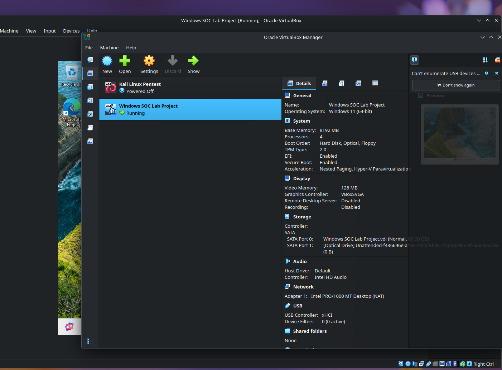

# Local SOC & SIEM Home Lab

## Phase 1: Architecture & Endpoint Instrumentation

### Executive Summary
Phase 1 establishes the foundational infrastructure, hypervisor topology, and host-level telemetry architecture for the local SOC environment[cite: 1]. The environment is engineered around an isolated virtual network topology separating the target endpoint (Blue Team) from the attacker node (Red Team) to ensure controlled execution of security assessments[cite: 1].

---

### 1. Virtualization Topology & Network Architecture

The lab runs on a hypervisor topology managed via Oracle VM VirtualBox, hosted on an Arch Linux-based distribution (**CachyOS**) for high-performance virtual machine management and resource scheduling[cite: 1].

- **Host Environment:** CachyOS (Arch Linux-based Hypervisor & Management Node)[cite: 1]

- **Target Node (Blue Team):** Windows 11 Pro configured as the primary log and telemetry source[cite: 1].

- **Attacker Node (Red Team):** Kali Linux provisioned for adversarial simulation[cite: 1].




---

### 2. Endpoint Instrumentation & Telemetry Pipeline

To achieve deep host-level visibility, native Windows event logging is augmented using **System Monitor (Sysmon)**[cite: 1]. Sysmon provides high-fidelity kernel- and user-space telemetry—including process creation, network socket connections, driver loads, and file modifications—which are critical for threat hunting and SIEM detection engineering[cite: 1].

#### Configuration & Deployment
Sysmon was deployed on the Windows 11 target node utilizing the industry-standard **SwiftOnSecurity** baseline configuration to filter out OS noise and capture high-value security events[cite: 1].

```powershell
# Directory provisioning and telemetry deployment
mkdir C:\Sysmon
cd C:\Sysmon

# Retrieve Sysmon binary and production-grade baseline ruleset
Invoke-WebRequest -Uri "[https://live.sysinternals.com/Sysmon64.exe](https://live.sysinternals.com/Sysmon64.exe)" -OutFile "Sysmon64.exe"
Invoke-WebRequest -Uri "[https://raw.githubusercontent.com/SwiftOnSecurity/sysmon-config/master/sysmonconfig-export.xml](https://raw.githubusercontent.com/SwiftOnSecurity/sysmon-config/master/sysmonconfig-export.xml)" -OutFile "sysmonconfig-export.xml"

# Service installation and configuration enforcement
.\Sysmon64.exe -i sysmonconfig-export.xml -accepteula
```

