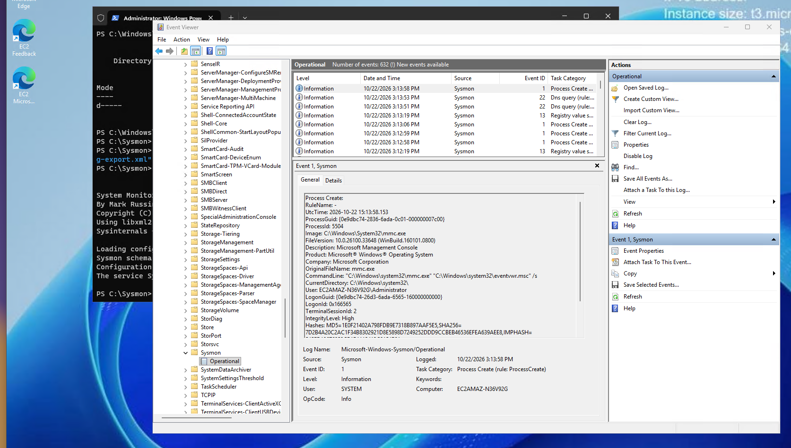

# Cloud-Based SOC & SIEM Home Lab

## Overview
This repository documents the architecture, configuration, and execution of an end-to-end SOC and SIEM home lab. The environment features a cloud-hosted Windows Server target machine, custom endpoint telemetry collection via Microsoft Sysmon, and centralized log ingestion.

### Architecture

* **Target Endpoint:** AWS EC2 Instance (`t3.micro`) running Windows Server.
* **Control / Management Host:** Local CachyOS (Arch Linux) using `xfreerdp3` for administrative access.
* **Attacker / Simulation Host:** Kali Linux (running as a local Virtual Machine on the CachyOS host for generating security events and testing detections).
* **Network Security:** Restrictive Security Group rules enforcing inbound RDP (port 3389) and other telemetry traffic strictly to authorized host IP addresses.

---

## Phase 1: Endpoint Provisioning & Telemetry Configuration

### 1. Host Provisioning & Access Control
* Provisioned a Windows Server instance on AWS Free Tier.
* Configured inbound firewall rules to restrict RDP access to the management IP.
* Established secure RDP remote access via CLI (`xfreerdp3`).

### 2. Sysmon Deployment & Configuration
To capture high-fidelity host-level telemetry beyond default Windows Event Logging, Microsoft Sysinternals Sysmon was deployed alongside SwiftOnSecurity's optimized configuration schema.

**Installation Steps:**
1. Created deployment directory `C:\Sysmon` and downloaded required binaries:
   ```powershell
   New-Item -ItemType Directory -Path "C:\Sysmon" -Force
   Set-Location "C:\Sysmon"
   Invoke-WebRequest -Uri "https://live.sysinternals.com/Sysmon64.exe" -OutFile "C:\Sysmon\Sysmon64.exe"
   Invoke-WebRequest -Uri "https://raw.githubusercontent.com/SwiftOnSecurity/sysmon-config/master/sysmonconfig-export.xml" -OutFile "C:\Sysmon\sysmonconfig-export.xml"
   .\Sysmon64.exe -accepteula -i sysmonconfig-export.xml
   ```
### 3. Telemetry Verification
Verified that high-fidelity telemetry events were actively recording via Windows Event Viewer.

**Sysmon Installation & Operational Logs:**


